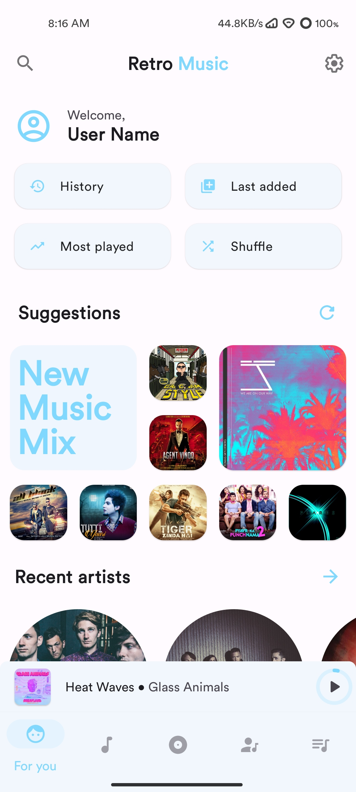
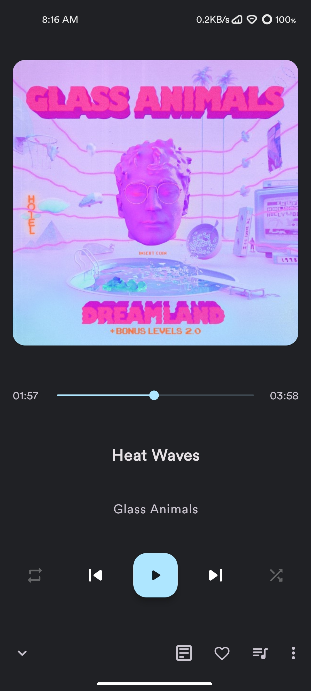
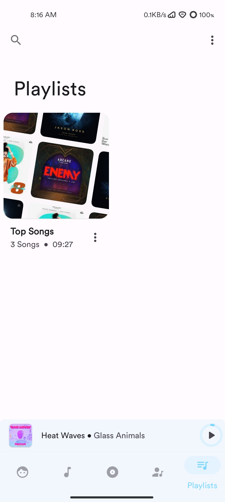
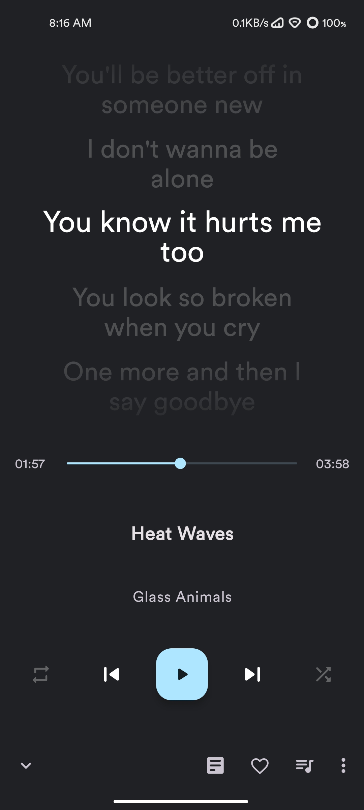
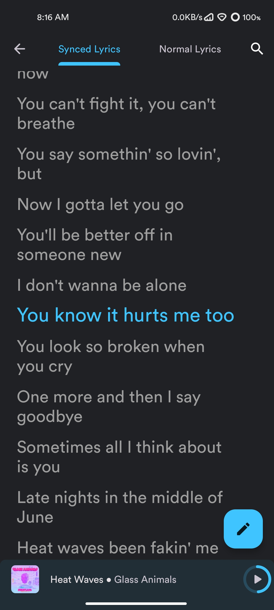

# Rsounds

<p align="center">
  
</p>

<p align="center">
  <strong>An offline-first Android music player</strong>
</p>

<p align="center">
  <a href="https://github.com/riynk/Rsounds/actions/workflows/android.yml"></a>
  
  
  
  
</p>

Rsounds is a local music player for Android. It is designed for listening to music stored on your device, with library browsing, playback controls, playlists, artwork, and synchronized lyrics.

> This repository is actively developed on the `RY-DEV` branch. Features and interface details may change while development continues.

## Features

### Music library and playback
- Browse local music by songs, albums, artists, playlists, genres, and folders.
- Playback queue with drag-and-drop reordering.
- Create, edit, import, and export playlists.
- Gapless playback and playback controls.
- Sleep timer, widgets, and lock-screen controls.
- Edit supported audio metadata with the tag editor.
- Artwork display using available track and artist metadata.

### Now Playing and lyrics
- Now Playing interface with the lyric presentation modes **Replace Cover** and **Over Cover**.
- A dedicated lyrics screen.
- Synchronized LRC lyrics and embedded/local lyrics support.
- Lyrics typography controls, including font size and line spacing.
- Bold lyric text as the default presentation.
- Per-track lyric timing offset and drift adjustment.
- Optional online line-by-line lyric translation with a selectable target language and locally cached results.
- Configurable blurred artwork background for lyric surfaces, using available metadata artwork or artist artwork with fallback behavior.

Online lyric translation requires an internet connection and a reachable translation service. Availability and translation quality depend on that external service. Core local music playback does not require an internet connection.

### Personalization
- Light, dark, and black appearance options.
- Player and lyric presentation settings.
- Artwork and background behavior options.

## Screenshots

The screenshots below are existing repository assets and may not reflect every current setting or the latest UI revision.

### Player and library
| Home | Player | Playlists |
|:---:|:---:|:---:|
|  |  |  |

### Lyrics
| Over Cover | Replace Cover |
|:---:|:---:|
|  |  |

## Download and build artifacts

There is no release download link documented here yet. Development builds are produced by GitHub Actions for pushes to `RY-DEV`.

1. Open [Android CI workflow runs](https://github.com/riynk/Rsounds/actions/workflows/android.yml).
2. Select a completed successful run.
3. Download the `Rsounds-debug-apk` artifact from the run's **Artifacts** section.

The workflow uploads debug APKs from the available product flavors. Artifacts are temporary and are retained for 14 days. A debug APK is intended for testing, not as a signed production release.

## Build from source

### Requirements
- JDK 21
- Android SDK compatible with the project's compile SDK (36)
- Internet access for Gradle dependency resolution

### Build commands

On Linux or macOS:

```bash
chmod +x gradlew
./gradlew lint
./gradlew app:assembleNormalDebug
./gradlew app:assembleFdroidDebug
```

To build all configured variants:

```bash
./gradlew app:assemble
```

Debug APK output paths are flavor-specific:

- `app/build/outputs/apk/normal/debug/`
- `app/build/outputs/apk/fdroid/debug/`

Some distribution or signing configurations may require local properties or credentials. Do not commit signing files, API keys, or other secrets.

## Project structure

- `:app` — Android application.
- `:appthemehelper` — shared theme and UI helper library.
- `app/src/main` — shared application implementation and resources.
- `app/src/normal` — normal distribution flavor integrations.
- `app/src/fdroid` — F-Droid-compatible flavor implementations.
- `.github/workflows/android.yml` — CI build and debug APK artifact workflow.

The application uses Kotlin and Java, XML layouts, Fragments, ViewBinding, AndroidX, Material Components, Room, Koin, Glide, and Gradle Kotlin DSL.

## Contributing

Bug reports and focused improvements are welcome. Please read [CONTRIBUTING.md](CONTRIBUTING.md) before opening an issue or pull request. Review [AGENTS.md](AGENTS.md) for repository-specific development guidance.

## License

Rsounds is distributed under the [GNU General Public License v3.0](LICENSE.md).

## Important scope

Rsounds is a local music player. It does not provide music downloading or a hosted music-streaming catalog. Online lyric translation is an optional network feature and is separate from music playback.
